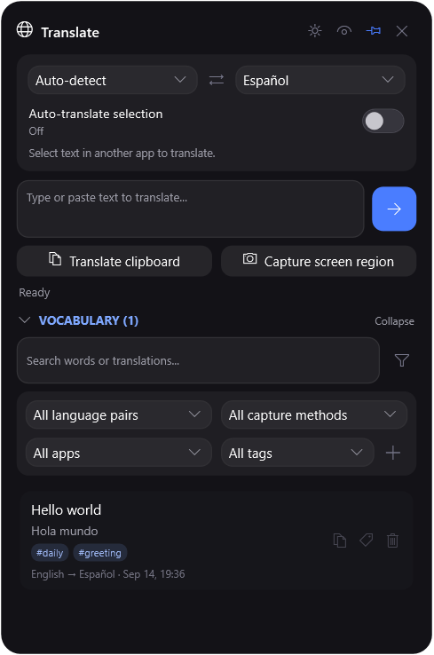
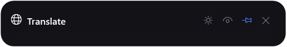
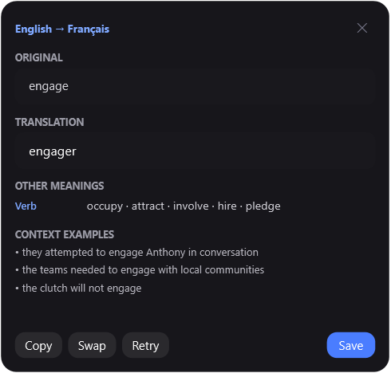
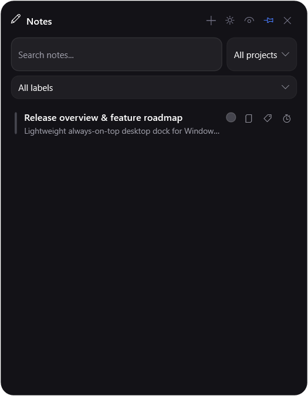

# Native Widget

[](https://github.com/Pelag-Michael/Native-Widget/releases/tag/v0.1.1-alpha)
[](https://github.com/Pelag-Michael/Native-Widget/releases/tag/v0.1.1-alpha)
[](https://dotnet.microsoft.com/download/dotnet/8.0)
[](https://github.com/Pelag-Michael/Native-Widget/actions/workflows/ci.yml)
[](LICENSE)

> A native, low-RAM Windows widget dock built with WPF and .NET 8 — no Electron,
> no bundled browser, no account required for local widgets.

Native Widget keeps Calendar, Tasks, Notes, Timers, Focus, OCR translation, and Projects
one hover away in small always-on-top windows. Google Calendar/Tasks sync is optional;
experimental Notion sync is available for Notes.

The radial launcher includes a compact window-tools panel for changing pin, ghost mode,
opacity, or visibility across every currently open widget at once; per-widget controls remain available.

<p align="center">
  
</p>

## Download

**[Download Native Widget v0.1.1-alpha for Windows](https://github.com/Pelag-Michael/Native-Widget/releases/download/v0.1.1-alpha/Native-Widget-v0.1.1-alpha-win-x64.zip)**

1. Download `Native-Widget-v*-win-x64.zip` from Releases.
2. Extract the zip anywhere you own.
3. Run `NativeWidget.exe`.

The main package includes the .NET runtime and works on 64-bit Windows 10 (build 19041+) and
Windows 11. A smaller framework-dependent package is also available for machines that already
have the [.NET 8 Desktop Runtime](https://dotnet.microsoft.com/download/dotnet/8.0).

> This project is currently an alpha release. Windows SmartScreen may warn about an unsigned
> executable; review the source and release checksums before running it.

## Why this exists

The original prototype used Electron and measured roughly 300–400 MB of RAM for a handful of
small panels. Native Widget replaces the browser runtime with WPF and the Windows desktop stack.

| | Native Widget | Electron-style desktop wrapper |
|---|---|---|
| UI runtime | WPF / Windows desktop | Chromium + Node.js |
| Bundled browser engine | No | Usually yes |
| Platform focus | Windows 10/11 | Often cross-platform |
| Idle footprint on the development machine¹ | 96.2 MB working set / 44.8 MB private | Varies by app |
| Framework-dependent publish size¹ | 25.3 MB | Varies by app |

¹ Measured on 4 August 2026 with the launcher idle. Hardware, enabled integrations, and open
widgets affect memory. The numbers are a reproducible reference, not a universal benchmark.

## Widgets

| Widget | What it does |
|---|---|
| **Calendar** | 14-day Google Calendar agenda; create, repeat, inspect and delete events |
| **Tasks** | Google Tasks lists, subtasks, due dates, descriptions, colors and pop-out lists |
| **Notes** | Rich text, links, images, file attachments, labels, reminders and optional two-way Notion sync |
| **Timers** | Named duration or deadline timers that survive app and machine restarts |
| **Focus** | Minimal Pomodoro-style focus sessions |
| **Translate** | Hover panel, manual/selection translation, screen OCR, dictionary meanings, usage examples and a tagged vocabulary notebook |
| **Projects** | Current-focus tracker with optional Explorer folder links |

Tasks and Notes can be assigned to projects and filtered by them. A workspace search finds
matching notes, tasks, projects, labels, events and timers from one place.

Press `Ctrl+Alt+K` to open search, then choose **Folders** to find directory names or paths.
Select a result to **Copy path**, **Copy CMD** (`cd /d "..."`), or **Open** it in Explorer.
The folder icon manages search roots; refresh rebuilds the local directory index in the
background and doubles as a cancel button. Typing filters the cached index. AppData,
dependency/build directories and directory junctions are skipped.

Settings can optionally restore the previous desktop session: every widget that was still
open returns at its last position and size after Native Widget or Windows starts again.

Settings includes **Invisible hover**: the launcher and other widgets are temporarily
hidden. Hover at the saved input position to reveal Quick AI; leaving its bounds hides
it without a delay. Drag the grip beside Paste to move the main bar and its hover position. Ctrl+Alt+Left briefly outlines
its hover position. The UI has Paste, copy-answer, send-arrow, follow-up,
Reset and settings actions. Copy-answer stays dimmed without an answer.

**Paste queues input without sending.** Each text paste appends to the draft. **+** opens the follow-up editor in its own floating
panel, with no extra Send button; the main send arrow submits its text with the draft. Clipboard images and screenshots append as PNG attachments
in `%TEMP%/NativeWidget/QuickAI` by default. In Quick AI settings, choose another folder
inside Temp. Existing queued images retain their paths if the folder changes.
The send arrow or Ctrl+Enter submits all queued text, the follow-up and all image
attachments together. Image paths are sent separately as Codex local-image attachments; a path string alone
in the prompt is not an AI image upload.
The draft remains until Reset. Reset clears text, follow-up, attachments and the displayed
answer, and deletes only this draft's generated PNGs. Normal close removes those images;
a forced process exit may leave files for system Temp cleanup.

Ctrl+Left copies in the focused app while this mode is active. With **Quicker** enabled
in Quick AI settings, a successful fresh copy also appends the selected text and dispatches
the complete draft immediately. Ordinary Paste and screenshots still queue without sending.
Quick AI uses the installed **Codex CLI app-server** with its existing sign-in. The worker
starts on first Send (or Load models), uses a separate temporary conversation and isolated
working folder, and streams the answer into the response panel. Choose a model and reasoning
effort in Quick AI settings; a blank model uses Codex's default. **Load models** reads the
catalog from the installed CLI. **System prompt** saves custom response instructions,
with a brief 1-3 sentence answer style by default. Changing it starts a new conversation
on the next Send. The send arrow becomes **Stop** while answering.
**Reset** clears input and cancels the active request while retaining conversation context;
**New chat** clears input and conversation context together. Restarting the app starts a new
conversation. Repeated Send with an unchanged successful input is ignored. Quicker input
received during an answer is queued as the next complete draft. Only one turn runs at once.
Images are copied privately for the active request, so Reset cannot remove a file while
Codex reads it; those copies are removed when the request finishes. Codex uses full access (`danger-full-access`)
with no approval prompts, as configured for this local widget. No API key is stored by the widget.

The receipt dot is green while any text or image is queued, including when the input
is hidden. A newly received screenshot/clipboard image flashes the dot yellow for two
seconds, then it returns to green if input remains or disappears if empty. Reset cancels
the flash. Turning this mode off hides the dot too. The dot has no border.

In **Settings > Quick AI - Capture & layout** (or **...**), configure a fixed screenshot
rectangle using X/Y/width/height in physical pixels, or draw it once with **Choose capture
area**. Ctrl+, captures it silently, without a selection overlay,
dimming or flash. Disable the fixed area to capture the monitor under the pointer.

Enable **Screenshot to AI** in the general Quick AI settings to send each Ctrl+, capture
immediately with its own editable prompt. It uses the current Capture area (or the monitor
under the pointer when fixed capture is off). Each request includes only its new image and
this prompt, excluding earlier draft text and attachments. The default prompt asks for a
brief answer in Vietnamese. Rapid captures queue in order while Codex is busy; Stop and
Reset cancel the pending queue. Clipboard image paste remains a manual draft attachment.

**Edit layout** reveals the demo panels, their gear buttons, and four visible resize corners
on Add input and Response. Outside edit mode, gears and corner markings disappear while
corner hit areas remain interactive. Drag a corner to resize, or Shift-drag to move.
Panel controls are grouped behind each panel's own gear: Bar has width, opacity, text/icon
size and colors; Dot has opacity and colors; Add input and Response each have text size,
opacity, text-only, auto-height and colors. General settings keep the Codex configuration,
capture area, screenshot prompt, Quicker and Edit layout toggles. These are grouped into
collapsed Layout, Codex, Quick modes and Capture sections. A Shortcuts section lists the
current keys with their scope, including AI copy/capture/send and layout controls. The
main Settings window also groups its sections and includes the same shortcut reference.

No response outline is drawn. Add input and Response default to text-only, without a
background or title outside layout editing. Frames shrink to 12 pixels per axis; narrow
widths wrap words downwards. Auto height extends downwards to retain all text; disable it
for a fixed-height box with mouse-wheel scrolling. Manually dragging a top/bottom edge or
corner vertically disables auto height automatically, so new text cannot expand the
chosen height. Edit layout raises an invisible panel
to at least 25% opacity temporarily so it can be repositioned. The bar widens as needed
to keep Paste visible when its icons become larger or its gear appears.

Each panel's color wheel changes only that panel. Colors, opacity, capture settings,
prompts and panel bounds live in `hover-ai-appearance.json`, independently of the original
launcher settings. **Demo AI** previews a sample answer labelled in its text. Buttons keep
the normal arrow cursor. Disabling Invisible hover restores the original widgets.

## See it in action

| Idle hover rail | Dictionary meanings and real usage context |
|---|---|
|  |  |

| Notes | Expanded Translate workspace |
|---|---|
|  |  |

## Privacy and integrations

- Local notes, timers, projects, settings, window-session state and vocabulary live under `%AppData%\NativeWidget`.
- Credentials are entered in the Settings widget; they are never committed to this repository.
- Google and Notion integrations are optional. Local widgets work without an online account.
- The translation provider currently uses an undocumented Google endpoint; see the
  [architecture notes](NativeWidget/docs/ARCHITECTURE.md#translate) before relying on it for sensitive text.

<details>
<summary><strong>Google Calendar and Tasks setup</strong></summary>

1. Open [Google Cloud Console](https://console.cloud.google.com), create a project, and enable
   the Google Calendar API and Google Tasks API.
2. Configure an External OAuth consent screen and add your email under **Test users**.
3. Create a **Web application** OAuth client.
4. Add `http://127.0.0.1:42813/callback` as an authorized redirect URI.
5. Paste the Client ID and Client secret into Native Widget Settings, then connect Calendar.

</details>

<details>
<summary><strong>Optional Notion Notes sync</strong></summary>

1. Create an integration at [notion.so/my-integrations](https://www.notion.so/my-integrations).
2. Connect that integration to the parent Notion page you want to use.
3. Paste the token and parent page ID into Settings, then enable Notion sync.

Native Widget creates a `NativeWidget Notes` database and syncs supported rich-text blocks,
images and attachments up to 20 MB. Unsupported blocks are left untouched. Deletion does not
currently propagate in either direction.

</details>

## Build from source

Requires the .NET 8 SDK.

```powershell
dotnet build NativeWidget/NativeWidget.csproj -c Release
dotnet run --project NativeWidget/NativeWidget.csproj
```

Create the same release archives used by GitHub Releases:

```powershell
./scripts/package-release.ps1 -Version 0.1.0
```

Architecture, storage formats and troubleshooting notes live in
[`NativeWidget/docs/ARCHITECTURE.md`](NativeWidget/docs/ARCHITECTURE.md). The
workspace-wide documentation map is [`docs/README.md`](docs/README.md).

## Keyboard shortcuts

| Shortcut | Action |
|---|---|
| `Ctrl+Alt+Left` | Briefly outline the launcher hover region |
| `Ctrl+Alt+F` | Find the original launcher when Invisible hover is off |
| `Ctrl+Alt+G` | Disable click-through mode on every widget |
| `Ctrl+Alt+K` | Search the workspace and indexed folders |
| `Ctrl+S` | Save the current note and push it to Notion immediately |

## Contributing

Bug reports, small focused pull requests, screenshots and accessibility feedback are welcome.
Read [CONTRIBUTING.md](CONTRIBUTING.md) before opening a pull request. Security issues should be
reported through [SECURITY.md](SECURITY.md), not a public issue.

MIT licensed — see [LICENSE](LICENSE).
